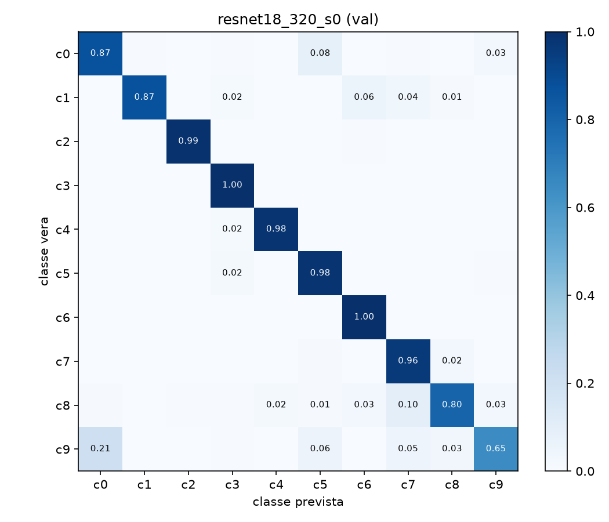

# Analisi degli errori v1

Modello: `resnet18_320_s0` (ResNet18, 320 letterbox, il migliore finora). Dati: **validazione**,
4 conducenti mai visti in training, 4.347 immagini. Il test set non è stato usato.
Riproduzione: `python -m dms.evaluate --run runs/kaggle/resnet18_320_s0` e
`python -m dms.explain.gradcam --run runs/kaggle/resnet18_320_s0 --top 30`.

Nessuna immagine del dataset compare in questo report (regole della competizione State Farm):
gli esempi e le mappe Grad-CAM sono stati guardati in locale e qui sono descritti a parole.

**In sintesi.** Il modello sbaglia l'8,8% delle immagini (382). Quasi metà degli errori
riguarda una sola classe, c9 "parlare col passeggero", spesso scambiata per guida sicura:
è un falso negativo, il tipo di errore più grave per un sistema di sicurezza. Gli errori
sicuri del modello seguono due schemi (telefono letto come bicchiere, braccio alzato letto
come "raggiungere dietro"), e Grad-CAM suggerisce che per c9 il modello usi lo sfondo
invece della direzione dello sguardo.

## Metriche

| Metrica | Valore |
|---|---|
| Accuracy | 0.912 |
| Macro-F1 | 0.908 |
| Log-loss | 0.2763 (identica alla misura su Kaggle: pipeline locale verificata) |

**Per classe** (recall = quante immagini di quella classe vengono riconosciute; precision =
quante delle previsioni di quella classe sono giuste):

| Classe | Precision | Recall | F1 |
|---|---|---|---|
| c0 guida sicura | 0.804 | 0.874 | 0.837 |
| c1 messaggi, destra | 0.995 | 0.872 | 0.929 |
| c2 telefono, destra | 0.996 | 0.991 | 0.993 |
| c3 messaggi, sinistra | 0.942 | 1.000 | 0.970 |
| c4 telefono, sinistra | 0.982 | 0.982 | 0.982 |
| c5 radio | 0.861 | 0.978 | 0.916 |
| c6 bere | 0.918 | 1.000 | 0.957 |
| c7 raggiungere dietro | 0.821 | 0.964 | 0.887 |
| c8 capelli e trucco | 0.907 | 0.801 | 0.851 |
| **c9 parlare col passeggero** | 0.917 | **0.647** | **0.759** |

**Confusioni principali** (quota della classe vera):

| Vera → prevista | Quota |
|---|---|
| c9 passeggero → c0 guida sicura | 21% |
| c8 capelli → c7 raggiungere dietro | 10% |
| c0 guida sicura → c5 radio | 8% |
| c1 messaggi destra → c6 bere | 6% |
| c9 passeggero → c5 radio | 6% |

**Per conducente:**

| Conducente | Immagini | Accuracy | Errori | Classi con più errori |
|---|---|---|---|---|
| p022 | 1.233 | 0.965 | 43 | c9 (29) |
| p024 | 1.226 | 0.940 | 73 | c9 (36), c1 (30) |
| p021 | 1.237 | 0.875 | 155 | c8 (60), c9 (37), c1 (28) |
| p039 | 651 | 0.829 | 111 | c9 (56), c0 (39) |

c9 è la classe con più errori per tutti e quattro i conducenti (158 dei 382 errori totali).

## Ipotesi scritte prima di guardare i risultati

| Ipotesi | Esito |
|---|---|
| Le coppie più confuse sono destra/sinistra: c2↔c4 e c1↔c3 | **Smentita.** c2, c3 e c4 hanno recall tra 0.98 e 1.00. La telecamera è dal lato del passeggero: un telefono nella mano destra (vicino, visibile) e uno nella sinistra (lontano, dietro la testa) danno foto molto diverse, non speculari |
| c7 sarà la classe riconosciuta meglio, perché la postura cambia molto | **A metà.** Recall alta (0.964) ma non la più alta (c3 e c6: 1.000), e precision tra le più basse (0.821): la postura "braccio lontano dal corpo" attira anche immagini di altre classi |
| Meno di 10 punti di accuracy tra il conducente migliore e il peggiore | **Smentita.** 13,6 punti (p022 0.965, p039 0.829) |

Il primo punto spiega anche un risultato del giorno 3: il flip orizzontale con scambio delle
etichette non ha aiutato, perché un'immagine "mano destra" specchiata non assomiglia a una
foto reale "mano sinistra" (il volante cambia lato, la mano resta vicina alla telecamera).

## I 30 errori più sicuri

I 30 errori con la confidenza più alta (tutti sopra 0.93), classificati a mano guardando le
immagini:

| Categoria | Errori | Cosa c'è dentro |
|---|---|---|
| Errore del modello (immagine chiara) | 18 | braccio alzato verso i capelli letto come "raggiungere dietro" (c8 → c7, 8); telefono in mano letto come bicchiere (c1/c2 → c6, 5); mano alla bocca letta come telefono (c8 → c4, 2); altri 3 |
| Etichetta dubbia | 9 | 6 da una sola sequenza di p022 etichettata c9 in cui la conducente guarda avanti, con le mani sul volante; 3 immagini di p021 che sembrano davvero la classe prevista |
| Occlusione | 2 | telefono in gran parte coperto dalla mano (c1 → c6) |
| Posa atipica | 1 | |

- **Pochi momenti, ripetuti.** I fotogrammi consecutivi sono quasi identici: due sole sequenze
  (p021 con il braccio alzato, p022 che guarda avanti) fanno 14 dei 30 errori. I 30 errori
  corrispondono a circa 10-12 situazioni distinte.
- **Errori sicuri ed errori incerti.** Tutti i 30 vengono da p021 e p022, nessuno da p039,
  che pure ha l'accuracy più bassa: p039 sbaglia spesso ma con poca sicurezza, p021 sbaglia
  con sicurezza. Per la log-loss pesano di più i secondi.

## Dove guarda il modello (Grad-CAM)

Mappe calcolate sull'ultimo blocco convoluzionale (`layer4`, griglia 10×10 a 320), per la
classe prevista e per quella vera:

- **Telefono → bere.** Entrambe le mappe sono calde sulla mano con il telefono e
  sull'avambraccio. Il modello guarda il punto giusto ma non riconosce l'oggetto: a questa
  risoluzione un telefono stretto in mano a metà petto e un bicchiere hanno la stessa
  forma, e il gesto del braccio pesa più dell'oggetto. È un problema di riconoscimento, non
  di attenzione.
- **Braccio alzato → raggiungere dietro.** La mappa di c7 è calda sul busto e sotto il
  braccio, quella di c8 sulla testa e sulla mano tra i capelli. L'indizio corretto c'è ma
  pesa meno della postura del corpo: una scorciatoia "braccio lontano dal corpo = c7".
- **c9 → c0 (p022).** La mappa di c0 è sulle mani al volante. La mappa di c9, la classe vera,
  è calda sul finestrino, sul parcheggio fuori e sul bordo dell'immagine, non sulla testa.
  Per "parlare col passeggero" il modello sembra usare lo sfondo invece della direzione dello
  sguardo: una possibile scorciatoia spuria, che con persone e luoghi nuovi non regge.

Cautele: Grad-CAM indica una zona, non un oggetto (la griglia è 10×10), e le mappe sono
indizi, non prove. Sono state guardate solo sugli errori più sicuri.

## Cosa fare per ogni famiglia di errori

| Famiglia | Ipotesi | Prova prevista |
|---|---|---|
| c9 passeggero → c0, sfondo nella mappa di c9 | il modello usa lo sfondo, non lo sguardo | ablazione con sfondo mascherato (giorno 10); più avanti un ritaglio del volto come ingresso aggiuntivo |
| Telefono ↔ bicchiere | l'oggetto è troppo piccolo a 320 | detector del telefono e modello a due rami con i ritagli delle mani (giorni 6-9) |
| Braccio alzato → c7 | scorciatoia sulla postura | ritagli di mani e testa nel modello a due rami; controllare se il problema resta con il ViT |
| Etichette dubbie (sequenza c9 di p022) | fotogrammi di transizione etichettati con la classe della sequenza | contarle anche nel training; non correggere le etichette di validazione, ma riportarne la stima |
| Conducente p039 | errori numerosi ma incerti (c9, c0) | accuratezza per conducente nella cross-validation per gruppi, per capire se è un caso isolato |

Le immagini di questa analisi (griglia degli errori e mappe Grad-CAM) restano in locale
(`testing_ground.ipynb`, `scratch/gradcam/`, entrambi esclusi da Git).
